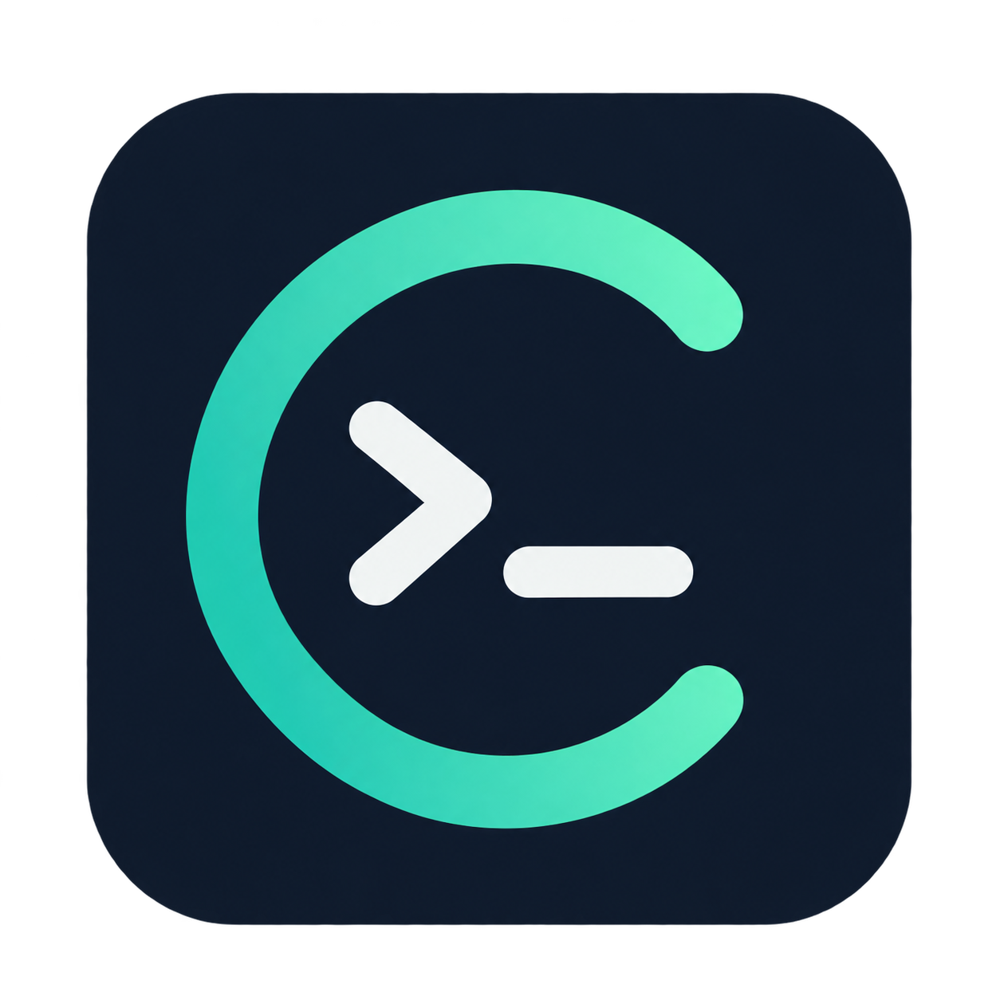

# Codex用量任务栏



在 Windows 10 / Windows 11 任务栏中查看 Codex 今日 Token 用量、订阅剩余额度和重置时间。


截图仅保留本组件区域；其中数值来自截图时的本机统计。

## 下载与使用

前往 [Releases 下载最新版](https://github.com/toggerdemetri-lgtm/codex-taskbar-usage/releases/latest)。

| 文件 | 用途 |
| --- | --- |
| `CodexTaskbar-v1.3.0-win10-win11-x64.zip` | 日常使用的便携版，解压后双击 `Codex用量任务栏.exe`，自带 .NET 运行环境。 |
| `CodexTaskbar-v1.3.0-source.zip` | 源码、构建脚本及回归测试的独立归档。 |
| `SHA256SUMS.txt` | 便携版和源码包的 SHA256 校验清单。 |

发行文件只提供便携版、源码和校验清单，以后不再发布插件版。页面中的 `Source code (zip / tar.gz)` 由 GitHub 自动生成，也是源码，不是程序。

目标系统为 Windows 10 2004（build 19041）及以上、Windows 11，x64 主屏水平任务栏；需要已安装、已登录且支持该系统的 Codex 桌面版。开机启动默认关闭。

### 兼容验证范围

| 环境 | 验证状态 |
| --- | --- |
| Windows 11 24H2 | 本机实际挂接、真实额度/用量、单实例与 Explorer 重启恢复验收。 |
| Windows 10 传统任务栏 | 已适配 UIA 标签/列表角色和只读 MSAA 控件边界，完成原生控件及 System-Aware DPI 模拟测试；尚无 Win10 真机/虚拟机验收。 |
| 小任务栏 / 100%～200% 缩放 | 双行字体高度和布局回归测试。 |

兼容适配与真实系统验收分别记录，详情见[验收记录](开发源码/docs/verification.md)。

## 功能

- 透明背景双行显示，跟随系统深浅主题与缩放。
- 今日 Token 按本地日期汇总本机桌面主会话增量，包含现存归档日志，每 2 秒检查，午夜切换日期。
- 剩余额度通常每 60 秒查询。5 小时和周额度同时存在时，显示剩余比例较低的周期；比例相同时选较短周期。
- 重置日期与当前所选周期对应，按本地时区显示。
- 剩余比例 11%～20% 显示橙色，10% 及以下显示红色；查询失败保留旧快照并标记过期。
- 连续3次可重试RPC失败后自动重建组件查询连接并立即再试，两次自动重建至少间隔2分钟。取得有效额度后自动清除过期标记；登录失效提示重新登录。
- 右键用量区域：立即刷新、查看用量详情、开机启动、退出。无额外托盘图标。
- 单实例运行，支持 Explorer 重启恢复，以及本地启动、停止、状态查询。

## 统计范围

“今日”是本机 Codex 桌面主会话的 Token 增量，排除 CLI 和子代理会话，不是账号所有设备的总用量。跨日会话扣除此前累计，重复快照不重复计数，缓存和推理子项不再次相加。

“剩余额度”是订阅额度，来自 Codex `app-server` 的只读接口。程序不读取凭据文件，不创建推理请求，不向第三方上传用量。

## 源码与构建

源码位于 [`开发源码`](开发源码)，采用 C#、.NET 10、WinForms 和 Win32。

安装 .NET 10 SDK 后，在 PowerShell 中运行：

```powershell
Set-Location .\开发源码
.\scripts\build.ps1
```

只运行行为测试：

```powershell
.\scripts\dotnet.ps1 run --project tests\CodexTaskbar.Tests -c Release
```

已通过 64 项行为测试、6 项查询恢复集成测试、8 项原生启动注册测试和 7 项 Windows 原生检查。原生检查可运行：

```powershell
.\scripts\dotnet.ps1 run --project tests\CodexTaskbar.WindowsTests -c Release
```

集成检查使用隔离假查询进程，并会短暂创建测试控件验证 MSAA 与 DPI，不能替代 Win10 真机验收。

## 本地控制

```powershell
.\Codex用量任务栏.exe --start
.\Codex用量任务栏.exe --menu
.\Codex用量任务栏.exe --status --output .\status.json
.\Codex用量任务栏.exe --stop
```

任务栏空间不足时会暂时隐藏，减少按钮后恢复；此时再次双击 EXE 仍可打开菜单。原生嵌入依赖 Explorer 窗口结构，Windows 更新后可能需要适配。

启用“开机启动”会同时设置当前用户Run项和直接指向程序的普通启动快捷方式。快捷方式的自动启动入口等待15秒让桌面就绪，并在等待前后检查开关；关闭时移除两处入口。升级后已启用自启动的用户，可关闭再开启一次以补建普通快捷方式。
